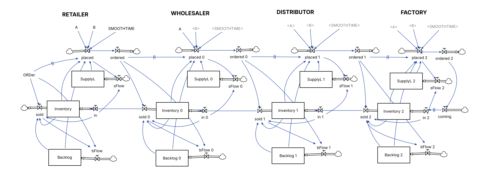
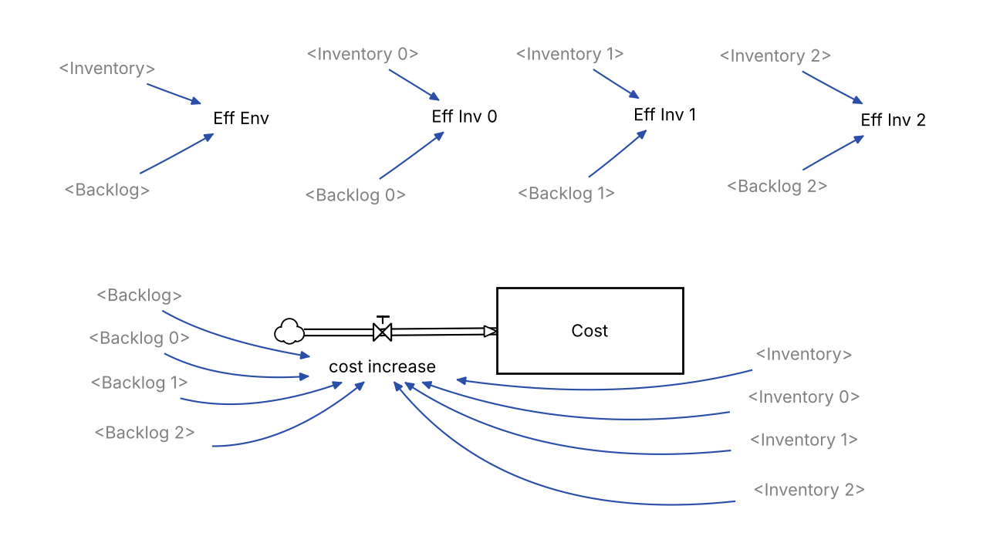

```{r setup, include=FALSE}
knitr::opts_chunk$set(echo = TRUE, message = FALSE, warning = FALSE,
                      fig.width = 9, fig.height = 4.8, fig.align = "center")
library(ggplot2)
library(knitr)
options(OutDec = ",")   # coma decimal en todo el informe

# Paleta fija por eslabón (se usa en todos los gráficos)
cols <- c("Consumidor" = "#7f7f7f", "Minorista" = "#1f77b4",
          "Mayorista" = "#2ca02c", "Distribuidor" = "#ff7f0e",
          "Fábrica" = "#d62728")
eslabones <- c("Minorista", "Mayorista", "Distribuidor", "Fábrica")
```

# Introducción

El objetivo de este trabajo es correr y analizar el modelo **`Beer_Game.mdl`** en Vensim. Es una versión en dinámica de sistemas del *Juego de la Cerveza* (*The Beer Distribution Game*). A partir de la simulación se busca:

1. explicar de qué se trata el juego y cómo se juega;
2. repasar la teoría básica de la gestión de la cadena de suministro (*Supply Chain Management*, SCM), en particular el **efecto látigo** (*bullwhip effect*);
3. interpretar los resultados del modelo y ver cómo cambian cuando se modifican los parámetros de decisión de los jugadores.

# ¿De qué se trata el juego?

## Origen

El Beer Game fue desarrollado en la década de 1960 en el MIT, en el grupo de **Jay W. Forrester**, creador de la *dinámica de sistemas* (*Industrial Dynamics*, 1961). Se popularizó con **John Sterman** (1989) y con el libro *La Quinta Disciplina* de Peter Senge (1990). Hoy se usa en universidades y empresas de todo el mundo para enseñar cómo la **estructura** de un sistema determina su **comportamiento**.

## La cadena

El juego simula una cadena de suministro de cerveza con **cuatro eslabones** en serie. Cada uno lo maneja un jugador (o un equipo):

```{r cadena, fig.height=2.4, echo=FALSE}
nodos <- data.frame(x = 1:5,
                    lab = c("Consumidor", "Minorista\n(Retailer)", "Mayorista\n(Wholesaler)",
                            "Distribuidor\n(Distributor)", "Fábrica\n(Factory)"),
                    col = names(cols))
flechas <- data.frame(a = 1:4 + .32, b = 2:5 - .32)
ggplot(nodos) +
  geom_segment(aes(x = a, xend = b, y = .18, yend = .18), data = flechas,
               colour = "grey40", arrow = arrow(length = unit(.18, "cm"))) +
  geom_segment(aes(x = b, xend = a, y = -.18, yend = -.18), data = flechas,
               colour = "grey40", arrow = arrow(length = unit(.18, "cm"))) +
  geom_label(aes(x, 0, label = lab, fill = col), colour = "white",
             fontface = "bold", size = 3.4, label.padding = unit(.35, "lines")) +
  annotate("text", x = 3, y = .42, label = "Pedidos (información): aguas arriba",
           size = 3.4, colour = "grey30") +
  annotate("text", x = 3, y = -.42, label = "Cerveza (material): aguas abajo",
           size = 3.4, colour = "grey30") +
  scale_fill_manual(values = cols, guide = "none") +
  coord_cartesian(xlim = c(.5, 5.5), ylim = c(-.5, .5)) + theme_void()
```

- **Minorista:** recibe la demanda del consumidor final y le hace pedidos al mayorista.
- **Mayorista:** abastece al minorista y le pide al distribuidor.
- **Distribuidor:** abastece al mayorista y le pide a la fábrica.
- **Fábrica:** abastece al distribuidor y decide cuánto producir.

## Reglas y cómo se explica el juego

En la versión de mesa, cada jugador tiene un tablero con su inventario y con cartas que representan los pedidos y los camiones en tránsito. Cada ronda equivale a **una semana** y sigue siempre la misma secuencia:

1. Recibir la cerveza que llega del proveedor (la que se despachó hace 2 semanas).
2. Leer el pedido que llega del cliente.
3. Despachar todo lo que se pueda: lo pedido más los pedidos atrasados (*backlog*). Lo que no se cubre queda como pedido pendiente.
4. Anotar inventario o backlog.
5. **Decidir cuánto pedirle al proveedor.** Es la **única decisión** del jugador.

Las condiciones que hacen interesante al juego son las siguientes:

- **Información local:** cada jugador solo ve su propio inventario y los pedidos de su cliente inmediato. No se puede hablar con los otros eslabones. Solo el minorista conoce la demanda real del consumidor.
- **Demoras:** un pedido tarda **1 semana** en llegar al proveedor y los envíos tardan **2 semanas** en llegar. En la fábrica, la producción también demora 2 semanas.
- **Costos:** cada caja en inventario cuesta **\$0,50 por semana** y cada caja pendiente (backlog) cuesta **\$1,00 por semana**. Quedarse sin stock es el doble de caro que tener de más.
- **Objetivo:** que el **costo total de toda la cadena** sea lo más bajo posible. Gana el equipo, no el eslabón.
- **Demanda:** al principio todo está en equilibrio (4 cajas/semana, 12 cajas de inventario en cada eslabón). En la semana 5 la demanda del consumidor sube **una sola vez a 8 cajas/semana** y se mantiene así hasta el final. Los jugadores no lo saben de antemano.

Al terminar, el coordinador muestra los gráficos de pedidos de cada eslabón. Casi siempre aparece el mismo patrón: un escalón chico de demanda se convierte en **oscilaciones enormes** que crecen a medida que se sube por la cadena. Cuando se les pregunta, los jugadores suelen culpar a una demanda "caótica" o a los otros jugadores. Pero la demanda fue un simple escalón: **el comportamiento lo genera la estructura del sistema** (demoras, información local y reglas de decisión), no las personas. Esa es la enseñanza central del juego.

# Teoría fundamental de la cadena de suministro

## Cadena de suministro y SCM

Una **cadena de suministro** es la red de organizaciones que participan en llevar un producto desde las materias primas hasta el consumidor final: proveedores, fábricas, centros de distribución, mayoristas y minoristas. Por ella circulan tres flujos:

| Flujo | Sentido | Ejemplo en el Beer Game |
|---|---|---|
| Material | Aguas abajo (hacia el cliente) | Cajas de cerveza |
| Información | Aguas arriba (hacia el proveedor) | Pedidos |
| Dinero | Aguas arriba | (implícito en los costos) |

La **gestión de la cadena de suministro (SCM)** busca coordinar estos flujos entre empresas para dar un buen nivel de servicio al menor costo total. El problema es que cada eslabón suele optimizar su propio resultado, y la suma de óptimos locales no es el óptimo global.

## Stocks, flujos y demoras

Desde la dinámica de sistemas, una cadena de suministro se modela con:

- **Stocks (niveles):** acumulaciones, por ejemplo inventario, backlog y pedidos en tránsito (*supply line*).
- **Flujos (tasas):** lo que cambia los stocks, por ejemplo despachos, recepciones y pedidos.
- **Demoras:** el tiempo que pasa entre una decisión y su efecto.
- **Lazos de realimentación:** el inventario influye en los pedidos, y los pedidos, con demora, vuelven a influir en el inventario. Es un **lazo de balance con demora**, la estructura típica que produce **oscilaciones**.

## El efecto látigo (*bullwhip effect*)

El **efecto látigo** es la **amplificación de la variabilidad de los pedidos a medida que se sube por la cadena**. Una variación chica en la demanda del consumidor genera variaciones cada vez más grandes en los pedidos del mayorista, del distribuidor y de la fábrica. Lo observaron Forrester (1961) y Procter & Gamble con los pañales Pampers, y lo formalizaron **Lee, Padmanabhan y Whang (1997)**, que identificaron cuatro causas operativas:

1. **Actualización del pronóstico de demanda:** cada eslabón pronostica a partir de los pedidos que recibe, no de la demanda real, y agrega stock de seguridad.
2. **Pedidos por lotes:** pedir en lotes grandes por costos fijos o transporte vuelve "a saltos" la demanda que ve el proveedor.
3. **Fluctuación de precios:** promociones y descuentos llevan a comprar por adelantado.
4. **Racionamiento y escasez:** si el proveedor raciona, los clientes "inflan" los pedidos, y después los cancelan.

**Sterman (1989)** agregó una causa **conductual**, que es justamente la que reproduce el modelo de este trabajo: los decisores **subestiman los pedidos que ya están en camino** (*supply line underweighting*). Cuando ven poco inventario, vuelven a pedir lo que ya habían pedido. Cuando todo eso llega juntos, el inventario se dispara.

**Consecuencias:** exceso de inventario y obsolescencia, quiebres de stock, mala utilización de capacidad, costos de transporte más altos y peor servicio.

**Cómo se mitiga:**

- **Compartir información** de la demanda real en toda la cadena (datos de punto de venta, EDI).
- **Reducir los tiempos de entrega** (*lead times*) de pedidos y envíos.
- **Coordinar y colaborar:** VMI (*Vendor Managed Inventory*), CPFR, pedidos más chicos y frecuentes, precios estables (EDLP).
- **Mejores reglas de decisión:** tener en cuenta los pedidos en tránsito y corregir las brechas de inventario de a poco.

# El modelo en Vensim

## Estructura

`Beer_Game.mdl` reproduce los cuatro eslabones (en el modelo se llaman *Retailer*, *Wholesaler*, *Distributor* y *Factory*; los sufijos `0`, `1` y `2` indican mayorista, distribuidor y fábrica). Cada eslabón tiene tres **stocks**:

| Stock | Significado | Valor inicial |
|---|---|---|
| `Inventory` | Cajas disponibles | 12 |
| `Backlog` | Pedidos pendientes de entrega | 0 |
| `SupplyL` | Línea de suministro: pedidos hechos y todavía no recibidos (relativos al equilibrio) | 0 |

Además, el stock `Cost` acumula el costo de toda la cadena.

## Diagrama del modelo

El modelo tiene dos vistas. La **vista 1** es la cadena completa: los cuatro eslabones uno al lado del otro, cada uno con sus tres stocks y los flujos que los conectan. Las variables entre `< >` y en gris son *shadow variables*, es decir, copias de un parámetro definido en otro lugar del diagrama. Las flechas con dos rayitas (‖) marcan una **demora**: el pedido que hace un eslabón (`placed`) le llega al de arriba como `ordered` una semana después.

```{r diagrama1, echo=FALSE, out.width="100%", fig.cap="Vista 1 del modelo en Vensim: diagrama de stocks y flujos de los cuatro eslabones."}

```

Se lee de izquierda a derecha. La demanda (`ORDer`) entra por el minorista y saca cerveza de su `Inventory` a través de `sold`. Si no alcanza, lo que falta se acumula en `Backlog`. Con esa información, el eslabón decide `placed` (cuánto pedir), que suma a su `SupplyL` y viaja como `ordered` al eslabón siguiente. La cerveza vuelve en sentido contrario: lo que despacha un eslabón (`sold 0`, `sold 1`, …) llega como `in` al de abajo dos semanas después. La fábrica no tiene proveedor: produce lo que pidió (`coming`).

```{r diagrama2, echo=FALSE, out.width="80%", fig.cap="Vista 2 del modelo: inventario efectivo de cada eslabón y acumulación del costo total."}

```

La **vista 2** tiene las variables auxiliares que se usan para mirar los resultados: el inventario efectivo de cada eslabón (`Eff Env`, `Eff Inv 0`, `Eff Inv 1` y `Eff Inv 2`) y el stock `Cost`. `Cost` crece cada semana con `cost increase`, que suma \$1 por cada caja en backlog y \$0,50 por cada caja en inventario de los cuatro eslabones.

## Ecuaciones principales

**Demanda del consumidor** (escalón de 4 a 8 en la semana 5):
$$\text{ORDer}(t) = 4 + \text{STEP}(4,\,5)$$

**Ventas o despachos:** se entrega lo que se pueda, entre lo disponible y lo requerido.
$$\text{sold}_i = \min(\text{Inventory}_i + \text{in}_i,\; \text{pedido recibido}_i + \text{Backlog}_i)$$

**Demoras** (`DELAY FIXED`): los pedidos tardan 1 semana y los envíos 2.
$$\text{ordered}_i(t) = \text{placed}_i(t-1), \qquad \text{in}_i(t) = \text{sold}_{i+1}(t-2)$$

**Regla de decisión: anclaje y ajuste (Sterman, 1989).** Es el corazón del modelo:
$$\text{placed}_i = \max\Big(0,\; \underbrace{\text{SMOOTH}(\text{pedido recibido}_i,\,1)}_{\text{demanda esperada (ancla)}} + A\,\big(\underbrace{12 - (\text{Inventory}_i - \text{Backlog}_i)}_{\text{brecha de inventario}} - B\cdot\text{SupplyL}_i\big)\Big)$$

El jugador pide lo que espera vender (ancla) y le suma un ajuste para cerrar la brecha entre el inventario deseado (12 cajas) y el **inventario efectivo** (inventario − backlog), descontando una parte de lo que ya tiene en camino.

**Costo:**
$$\frac{d\,\text{Cost}}{dt} = 1\cdot\sum_i \text{Backlog}_i + 0{,}5\cdot\sum_i \text{Inventory}_i$$

## Parámetros

| Parámetro | Valor | Interpretación |
|---|---|---|
| `A` | 0,25 | Fracción de la brecha de inventario que se corrige por semana (velocidad de ajuste) |
| `B` | 0,33 | Peso que se le da a la línea de suministro. Con `B = 1` se tendrían en cuenta todos los pedidos en tránsito; con 0,33 se "olvidan" dos tercios |
| `SMOOTHTIME` | 1 semana | Tiempo de suavizado del pronóstico |
| Inventario deseado | 12 cajas | Igual al inicial |
| Horizonte | 36 semanas | `TIME STEP` = 1 semana, Euler |

`B = 0,33` y `A = 0,25` están en el rango que Sterman estimó a partir de jugadores reales: corrigen la brecha con fuerza pero le prestan poca atención a lo que ya pidieron.

# Simulación

## Réplica del modelo en R

La función `beer_game()` aplica las ecuaciones del `.mdl` semana a semana. Los parámetros `A`, `B` y `SMOOTHTIME` quedan como argumentos para poder hacer el análisis de sensibilidad.

```{r modelo}
beer_game <- function(A = 0.25, B = 0.33, SMOOTHTIME = 1, T_final = 36,
                      demanda = function(t) 4 + ifelse(t >= 5, 4, 0)) {
  n  <- T_final + 1                    # semanas 0..36
  tt <- 0:T_final
  m  <- function() matrix(0, n, 4)     # columnas: minorista, mayorista, distribuidor, fábrica
  inv <- m(); back <- m(); sl <- m(); sm <- m()
  placed <- m(); ordered_in <- m(); arrive <- m(); sold <- m()
  ORDer <- demanda(tt)
  inv[1, ] <- 12
  cost <- numeric(n); cost_esl <- m()

  lag <- function(x, k, t, init = 4) if (t - k < 1) init else x[t - k]

  for (t in 1:n) {
    # Pedido que recibe cada eslabón: el minorista recibe la demanda y el resto
    # el pedido del eslabón de abajo, con 1 semana de demora
    ordered_in[t, 1] <- ORDer[t]
    for (i in 2:4) ordered_in[t, i] <- lag(placed[, i - 1], 1, t)
    # Llegadas de cerveza (2 semanas de demora). La fábrica recibe su producción:
    # coming = ordered 2 = pedido de la fábrica con 1 semana de demora
    for (i in 1:3) arrive[t, i] <- lag(sold[, i + 1], 2, t)
    coming <- function(s) if (s < 1) 4 else lag(placed[, 4], 1, s)
    arrive[t, 4] <- if (t - 2 < 1) 4 else coming(t - 2)
    # SMOOTH: el stock arranca en el valor inicial de su entrada
    if (t == 1) sm[1, ] <- ordered_in[1, ]
    # Despachos y pedidos
    sold[t, ]   <- pmin(inv[t, ] + arrive[t, ], ordered_in[t, ] + back[t, ])
    placed[t, ] <- pmax(0, sm[t, ] + A * (12 - (inv[t, ] - back[t, ]) - B * sl[t, ]))
    # Costo (flujo)
    cost_esl[t, ] <- 1 * back[t, ] + 0.5 * inv[t, ]
    # Integración de Euler (dt = 1)
    if (t < n) {
      inv[t + 1, ]  <- inv[t, ]  + arrive[t, ] - sold[t, ]
      back[t + 1, ] <- back[t, ] + ordered_in[t, ] - sold[t, ]
      sl[t + 1, ]   <- sl[t, ]   + placed[t, ] - arrive[t, ]
      sm[t + 1, ]   <- sm[t, ]   + (ordered_in[t, ] - sm[t, ]) / SMOOTHTIME
      cost[t + 1]   <- cost[t] + sum(cost_esl[t, ])
    }
  }
  larga <- function(mat, var) data.frame(semana = rep(tt, 4),
                                         eslabon = factor(rep(eslabones, each = n), eslabones),
                                         variable = var, valor = as.vector(mat))
  list(demanda = data.frame(semana = tt, ORDer = ORDer),
       series = rbind(larga(placed, "Pedidos realizados"),
                      larga(inv - back, "Inventario efectivo"),
                      larga(inv, "Inventario"), larga(back, "Backlog"),
                      larga(sl, "Línea de suministro")),
       costo = data.frame(semana = tt, Cost = cost),
       costo_eslabon = setNames(colSums(cost_esl[-n, ]), eslabones))
}

base <- beer_game()
```

## Validación contra el modelo de Vensim {#validacion}

El archivo `resultados_vensim_mdl.csv` tiene la salida del `.mdl` original. Comparamos las variables clave:

```{r validacion}
ref <- read.csv("resultados_vensim_mdl.csv")
sim <- base$series
get <- function(var, esl) sim$valor[sim$variable == var & sim$eslabon == esl]
comp <- data.frame(
  Variable = c("placed (minorista)", "placed 0 (mayorista)", "placed 1 (distribuidor)",
               "placed 2 (fábrica)", "Eff Env (minorista)", "Eff Inv 2 (fábrica)", "Cost"),
  `Error absoluto máximo` = c(
    max(abs(get("Pedidos realizados", "Minorista")    - ref$placed)),
    max(abs(get("Pedidos realizados", "Mayorista")    - ref$placed_0)),
    max(abs(get("Pedidos realizados", "Distribuidor") - ref$placed_1)),
    max(abs(get("Pedidos realizados", "Fábrica")      - ref$placed_2)),
    max(abs(get("Inventario efectivo", "Minorista")   - ref$Eff_Env)),
    max(abs(get("Inventario efectivo", "Fábrica")     - ref$Eff_Inv_2)),
    max(abs(base$costo$Cost - ref$Cost))), check.names = FALSE)
comp$`Error absoluto máximo` <- signif(comp$`Error absoluto máximo`, 3)
kable(comp, caption = "Diferencia máxima entre la réplica en R y el modelo .mdl (36 semanas)")
```

Las diferencias son prácticamente cero (error de redondeo), así que la réplica en R se comporta igual que el modelo de Vensim.

# Resultados

## Pedidos: el efecto látigo

```{r pedidos}
ped <- subset(base$series, variable == "Pedidos realizados")
dem <- data.frame(semana = base$demanda$semana, eslabon = "Consumidor",
                  valor = base$demanda$ORDer)
ggplot() +
  geom_step(data = dem, aes(semana, valor, colour = eslabon), linewidth = 1, linetype = 2) +
  geom_line(data = ped, aes(semana, valor, colour = eslabon), linewidth = 1) +
  scale_colour_manual(values = cols, breaks = names(cols)) +
  labs(title = "Pedidos realizados por cada eslabón",
       subtitle = "Escalón de demanda de 4 a 8 cajas/semana en la semana 5",
       x = "Semana", y = "Cajas / semana", colour = NULL) +
  theme_minimal(base_size = 12) + theme(legend.position = "top")
```

El consumidor solo duplica su demanda (de 4 a 8), pero:

- el **minorista** pide como máximo unas `r round(max(get("Pedidos realizados","Minorista")),1)` cajas;
- el **mayorista** llega a `r round(max(get("Pedidos realizados","Mayorista")),1)`;
- el **distribuidor** a `r round(max(get("Pedidos realizados","Distribuidor")),1)`;
- la **fábrica** a `r round(max(get("Pedidos realizados","Fábrica")),1)` cajas/semana, casi **4 veces** la demanda nueva.

Después de las semanas 24–25 los tres eslabones de arriba **dejan de pedir por completo** (pedido = 0), porque reciben todo lo que habían pedido de más. Ese es el efecto látigo: la señal se amplifica y se retrasa a medida que sube por la cadena.

## Inventario efectivo

```{r inventario}
ie <- subset(base$series, variable == "Inventario efectivo")
ggplot(ie, aes(semana, valor, colour = eslabon)) +
  geom_hline(yintercept = 12, linetype = 3, colour = "grey40") +
  geom_hline(yintercept = 0, colour = "grey70") +
  geom_line(linewidth = 1) +
  annotate("text", x = 0.5, y = 15, label = "Deseado = 12", hjust = 0, size = 3.4, colour = "grey30") +
  scale_colour_manual(values = cols) +
  labs(title = "Inventario efectivo (inventario − backlog)",
       subtitle = "Valores negativos = pedidos pendientes",
       x = "Semana", y = "Cajas", colour = NULL) +
  theme_minimal(base_size = 12) + theme(legend.position = "top")
```

Se ve el patrón típico del juego. Primero todos los eslabones se quedan sin stock y acumulan backlog: la fábrica llega a unas `r round(-min(get("Inventario efectivo","Fábrica")))` cajas pendientes. Después, cuando llega todo lo pedido, el inventario sube muy por encima de lo deseado: la fábrica termina con unas `r round(max(get("Inventario efectivo","Fábrica")))` cajas, cerca de **6 veces** el objetivo de 12. El sistema **sobrerreacciona** en las dos direcciones.

## Costos

```{r costos}
cf <- data.frame(eslabon = factor(eslabones, eslabones), costo = base$costo_eslabon)
ggplot(cf, aes(eslabon, costo, fill = eslabon)) +
  geom_col(width = .6) +
  geom_text(aes(label = paste0("$", format(round(costo), big.mark = ".", decimal.mark = ","))), vjust = -.4, size = 4) +
  scale_fill_manual(values = cols, guide = "none") +
  scale_y_continuous(expand = expansion(mult = c(0, .1))) +
  labs(title = sprintf("Costo acumulado en 36 semanas: $%s",
                       format(round(tail(base$costo$Cost, 1), 2), big.mark = ".", decimal.mark = ",")),
       x = NULL, y = "Costo ($)") +
  theme_minimal(base_size = 12)
```

## Indicadores del efecto látigo

Como medida de amplificación se usa el cociente entre la varianza de los pedidos de cada eslabón y la varianza de la demanda del consumidor. Un valor mayor que 1 indica efecto látigo.

```{r indicadores}
var_dem <- var(base$demanda$ORDer)
ind <- do.call(rbind, lapply(eslabones, function(e) {
  p <- get("Pedidos realizados", e); ie <- get("Inventario efectivo", e)
  data.frame(`Eslabón` = e,
             `Pedido máx.` = round(max(p), 1),
             `Desvío pedidos` = round(sd(p), 2),
             `Amplificación (var/var demanda)` = round(var(p) / var_dem, 1),
             `Backlog máx.` = round(max(get("Backlog", e)), 1),
             `Inventario máx.` = round(max(get("Inventario", e)), 1),
             `Costo ($)` = round(base$costo_eslabon[e], 1), check.names = FALSE)
}))
rownames(ind) <- NULL
kable(ind, caption = "Indicadores por eslabón – escenario base (A = 0,25; B = 0,33)",
      format.args = list(decimal.mark = ","))
```

La amplificación crece en cada paso aguas arriba: el desvío de los pedidos de la fábrica es unas cuatro veces el del minorista. El distribuidor y la fábrica suman más de la mitad del costo de la cadena. El distribuidor es el que más paga porque queda en el medio: sufre el backlog más grande (le pide a una fábrica que tarda en reaccionar) y después también un sobrestock grande.

# Análisis de sensibilidad

¿Qué pasa si los jugadores le prestan más atención a la línea de suministro (`B`) o corrigen la brecha de inventario más despacio (`A`)? Se corrió el modelo con distintas combinaciones:

```{r sensibilidad}
esc <- expand.grid(A = c(0.1, 0.25, 0.5), B = c(0, 0.33, 0.66, 1))
esc$`Costo total` <- NA; esc$`Pedido máx. fábrica` <- NA; esc$`Amplif. fábrica` <- NA
for (k in seq_len(nrow(esc))) {
  s <- beer_game(A = esc$A[k], B = esc$B[k])
  pf <- with(s$series, valor[variable == "Pedidos realizados" & eslabon == "Fábrica"])
  esc$`Costo total`[k]        <- round(tail(s$costo$Cost, 1))
  esc$`Pedido máx. fábrica`[k] <- round(max(pf), 1)
  esc$`Amplif. fábrica`[k]    <- round(var(pf) / var(s$demanda$ORDer), 1)
}
kable(esc, caption = "Sensibilidad del costo y de la amplificación a los parámetros A y B",
      format.args = list(decimal.mark = ",", big.mark = "."))
```

```{r sens_graf}
sb <- do.call(rbind, lapply(c(0, 0.33, 1), function(b) {
  s <- beer_game(B = b)
  d <- subset(s$series, variable == "Pedidos realizados" & eslabon == "Fábrica")
  d$escenario <- paste0("B = ", b); d
}))
ggplot(sb, aes(semana, valor, colour = escenario)) +
  geom_step(data = base$demanda, aes(semana, ORDer), inherit.aes = FALSE,
            colour = "grey50", linetype = 2) +
  geom_line(linewidth = 1) +
  scale_colour_manual(values = c("#d62728", "#ff7f0e", "#1f77b4")) +
  labs(title = "Pedidos de la fábrica según el peso dado a la línea de suministro (A = 0,25)",
       subtitle = "Línea punteada: demanda del consumidor",
       x = "Semana", y = "Cajas / semana", colour = NULL) +
  theme_minimal(base_size = 12) + theme(legend.position = "top")
```

```{r best, include=FALSE}
mejor <- esc[which.min(esc$`Costo total`), ]
peor  <- esc[which.max(esc$`Costo total`), ]
```

**Lectura:**

- Con **`B = 1`** (el jugador tiene en cuenta todo lo que ya pidió), las oscilaciones casi desaparecen y el costo baja mucho. Con **`B = 0`** (ignora la línea de suministro) el efecto látigo es máximo.
- Una **`A` más alta** (corregir la brecha con más fuerza) empeora mucho la inestabilidad cuando `B` es bajo: es "pisar el acelerador" sobre un lazo con demora. En cambio, con `B = 1` corregir más rápido sí conviene, porque el jugador ya no pide dos veces lo mismo.
- El mejor escenario de la tabla es A = `r mejor$A` y B = `r mejor$B`, con un costo de \$`r format(mejor[["Costo total"]], big.mark = ".", decimal.mark = ",")`. El peor es A = `r peor$A` y B = `r peor$B`, con \$`r format(peor[["Costo total"]], big.mark = ".", decimal.mark = ",")`.

Esto confirma la conclusión de Sterman: el problema no es la demanda sino la **regla de decisión**, en particular no tener en cuenta los pedidos en tránsito.

# Jugando con los parámetros

Además de la tabla anterior, probamos qué pasa al mover **un parámetro por vez** y dejar el resto en el valor base (`A = 0,25`, `B = 0,33`, `SMOOTHTIME = 1`, escalón de 4 a 8). Es lo mismo que mover los deslizadores de un parámetro en Vensim y ver cómo cambian las curvas. En cada prueba se mira la **fábrica**, que es donde el efecto látigo se nota más: sus pedidos y su inventario efectivo.

```{r exp_funciones}
# Corre varios escenarios y arma una tabla larga con los resultados de la fábrica
correr <- function(escenarios) {
  do.call(rbind, lapply(names(escenarios), function(nom) {
    s <- do.call(beer_game, escenarios[[nom]])
    d <- subset(s$series, eslabon == "Fábrica" &
                  variable %in% c("Pedidos realizados", "Inventario efectivo"))
    d$escenario <- nom
    d
  }))
}
resumen <- function(escenarios, experimento) {
  do.call(rbind, lapply(names(escenarios), function(nom) {
    s  <- do.call(beer_game, escenarios[[nom]])
    pf <- with(s$series, valor[variable == "Pedidos realizados"  & eslabon == "Fábrica"])
    ie <- with(s$series, valor[variable == "Inventario efectivo" & eslabon == "Fábrica"])
    data.frame(Experimento = experimento, Escenario = nom,
               `Costo total ($)` = round(tail(s$costo$Cost, 1)),
               `Pedido máx. fábrica` = round(max(pf), 1),
               `Faltante máx. fábrica` = round(-min(ie)),
               `Sobrestock máx. fábrica` = round(max(ie)),
               check.names = FALSE)
  }))
}
graf_exp <- function(escenarios, titulo, paleta) {
  d <- correr(escenarios)
  d$escenario <- factor(d$escenario, names(escenarios))
  d$variable  <- factor(d$variable, c("Pedidos realizados", "Inventario efectivo"),
                        c("Pedidos de la fábrica (cajas/semana)", "Inventario efectivo de la fábrica (cajas)"))
  ggplot(d, aes(semana, valor, colour = escenario)) +
    geom_hline(yintercept = 0, colour = "grey70") +
    geom_line(linewidth = 0.9) +
    facet_wrap(~variable, scales = "free_y") +
    scale_colour_manual(values = paleta) +
    labs(title = titulo, x = "Semana", y = NULL, colour = NULL) +
    theme_minimal(base_size = 12) + theme(legend.position = "top")
}
pal4 <- c("#1f77b4", "#2ca02c", "#ff7f0e", "#d62728", "#9467bd")
```

## Prueba 1: velocidad de corrección (`A`)

`A` dice qué parte de la brecha de inventario corrige el jugador cada semana. Con `A = 0` no corrige nada y pide solo lo que espera vender. Con `A = 1` intenta cerrar toda la brecha en una semana.

```{r exp_A, fig.height=4.2}
escA <- list("A = 0" = list(A = 0), "A = 0,1" = list(A = 0.1), "A = 0,25 (base)" = list(A = 0.25),
             "A = 0,5" = list(A = 0.5), "A = 1" = list(A = 1))
tA <- resumen(escA, "A")
graf_exp(escA, "Prueba 1: cambiando A (B = 0,33)", pal4)
```

- Cuanto más alta es `A`, más violenta es la reacción. Con `A = 1` la fábrica llega a pedir `r tA[5, 4]` cajas por semana y el costo sube a \$`r format(tA[5, 3], big.mark = ".")`, casi el triple del caso base.
- Con `A = 0` las curvas quedan planas y el costo es bajo (\$`r format(tA[1, 3], big.mark = ".")`), pero hay trampa: como nadie corrige, el faltante que se genera en el escalón **no se recupera nunca** y la cadena queda trabajando con backlog para siempre.
- Lo que se busca es un punto medio: corregir, pero sin sobrerreaccionar.

## Prueba 2: atención a la línea de suministro (`B`)

`B` dice cuánto tiene en cuenta el jugador lo que ya pidió y todavía no le llegó.

```{r exp_B, fig.height=4.2}
escB <- list("B = 0" = list(B = 0), "B = 0,33 (base)" = list(B = 0.33),
             "B = 0,66" = list(B = 0.66), "B = 1" = list(B = 1))
tB <- resumen(escB, "B")
graf_exp(escB, "Prueba 2: cambiando B (A = 0,25)", pal4)
```

- Es el parámetro que más cambia el resultado. Con `B = 0` (el jugador se olvida de lo que ya pidió) la fábrica termina con unas `r tB[1, 6]` cajas de sobrestock y el costo llega a \$`r format(tB[1, 3], big.mark = ".")`.
- Con `B = 1` el inventario efectivo de la fábrica nunca pasa de 12 cajas, así que no hay sobrestock: solo aparece el faltante inicial y después se corrige sin rebotar. El costo baja a \$`r format(tB[4, 3], big.mark = ".")`.
- Pasar de `B = 0,33` a `B = 0,66` ya reduce el costo a menos de la mitad.

## Prueba 3: suavizado del pronóstico (`SMOOTHTIME`)

`SMOOTHTIME` es cuántas semanas tarda el jugador en "creerse" que la demanda cambió. Con 1 semana reacciona enseguida. Con 8 semanas sigue pensando un buen tiempo que la demanda es 4.

```{r exp_ST, fig.height=4.2}
escST <- list("SMOOTHTIME = 1 (base)" = list(SMOOTHTIME = 1), "SMOOTHTIME = 2" = list(SMOOTHTIME = 2),
              "SMOOTHTIME = 4" = list(SMOOTHTIME = 4), "SMOOTHTIME = 8" = list(SMOOTHTIME = 8))
tST <- resumen(escST, "SMOOTHTIME")
graf_exp(escST, "Prueba 3: cambiando SMOOTHTIME (A = 0,25; B = 0,33)", pal4)
```

- Suavizar más el pronóstico **no ayuda** con la regla base: el costo sube de \$`r format(tST[1, 3], big.mark = ".")` a \$`r format(tST[4, 3], big.mark = ".")`. Como el ancla tarda en subir, al principio el jugador pide de menos, se acumula más backlog y después la corrección vía `A` es más grande.
- Con `SMOOTHTIME` alto las oscilaciones también se estiran: el pico de sobrestock llega más tarde y con 8 semanas todavía no terminó de formarse al final de la simulación.

## Prueba 4: otra forma de demanda

Acá no se toca la regla de decisión sino lo que hace el consumidor. Se compara el escalón base con un escalón más chico (de 4 a 6), con un **pulso** (la demanda sube a 8 una sola semana y vuelve a 4) y con una suba que dura 5 semanas.

```{r exp_dem, fig.height=4.2}
escD <- list("Escalón 4 → 8 (base)" = list(),
             "Escalón 4 → 6" = list(demanda = function(t) 4 + ifelse(t >= 5, 2, 0)),
             "Pulso: 8 solo en la semana 5" = list(demanda = function(t) 4 + ifelse(t == 5, 4, 0)),
             "8 durante 5 semanas" = list(demanda = function(t) 4 + ifelse(t >= 5 & t < 10, 4, 0)))
tD <- resumen(escD, "Demanda")
graf_exp(escD, "Prueba 4: cambiando la demanda (A = 0,25; B = 0,33)", pal4)
```

- Lo más llamativo es el **pulso**: el consumidor compra 4 cajas de más **una sola vez**, y aun así la fábrica llega a pedir `r tD[3, 4]` cajas en una semana y llega a tener unas `r tD[3, 6]` cajas de sobrestock. Además, la cadena sigue oscilando hasta el final de la simulación.
- Cuando la suba dura 5 semanas y después se termina, la fábrica queda casi igual de expuesta que con el escalón permanente, porque los pedidos que hizo en la suba le siguen llegando cuando la demanda ya bajó.
- Un cambio chico y pasajero en la demanda alcanza para desordenar toda la cadena. Por eso las empresas reales sufren el efecto látigo aunque su demanda final sea bastante estable.

## Prueba 5: combinando lo aprendido

Con lo que vimos, armamos una regla "mejorada": **tener en cuenta todo lo que ya se pidió (`B = 1`)** y, como ya no se pide dos veces lo mismo, corregir la brecha más rápido (**`A = 0,5`**). Se compara con la regla base en los cuatro eslabones.

```{r exp_comb, fig.height=6}
mej <- beer_game(A = 0.5, B = 1)
comb <- rbind(transform(subset(base$series, variable %in% c("Pedidos realizados", "Inventario efectivo")),
                        regla = "Base (A = 0,25; B = 0,33)"),
              transform(subset(mej$series,  variable %in% c("Pedidos realizados", "Inventario efectivo")),
                        regla = "Mejorada (A = 0,5; B = 1)"))
comb$variable <- factor(comb$variable, c("Pedidos realizados", "Inventario efectivo"))
tC <- resumen(list("Mejorada (A = 0,5; B = 1)" = list(A = 0.5, B = 1)), "Combinada")
ggplot(comb, aes(semana, valor, colour = regla)) +
  geom_hline(yintercept = 0, colour = "grey70") +
  geom_line(linewidth = 0.9) +
  facet_grid(variable ~ eslabon, scales = "free_y") +
  scale_colour_manual(values = c("#d62728", "#1f77b4")) +
  labs(title = "Regla base vs. regla mejorada en toda la cadena", x = "Semana", y = NULL, colour = NULL) +
  theme_minimal(base_size = 11) + theme(legend.position = "top")
```

Con la regla mejorada el costo total baja de \$`r format(round(tail(base$costo$Cost, 1)), big.mark = ".")` a \$`r format(tC[1, 3], big.mark = ".")` (`r round(100 * (1 - tC[1, 3] / tail(base$costo$Cost, 1)))` % menos). Cada eslabón tiene un solo pico de pedido cuando le llega el cambio (la fábrica llega a `r round(max(with(mej$series, valor[variable == "Pedidos realizados" & eslabon == "Fábrica"])), 1)` cajas una semana), pero enseguida se acomoda en 8 cajas por semana y **no vuelve a oscilar**. Ningún eslabón acumula sobrestock. Sigue habiendo un faltante al principio, que es inevitable porque la cerveza tarda en llegar.

Un detalle del modelo: con esta regla el inventario efectivo se estabiliza cerca de **0** y no vuelve a 12. Pasa porque la línea de suministro deseada no cambia cuando sube la demanda. Al pedir 8 por semana hay más cajas en camino que antes, y la regla las cuenta como si ya fueran stock. Para que el inventario vuelva a 12 habría que agregar al modelo una línea de suministro deseada que crezca con la demanda, como propone Sterman.

## Resumen de todas las pruebas

```{r exp_tabla}
kable(rbind(tA, tB, tST, tD, tC), caption = "Resultados de cada prueba (36 semanas)",
      format.args = list(decimal.mark = ",", big.mark = "."))
```

**Lo que nos dejó jugar con el modelo:** las palancas que más pesan son las que están en la cabeza del jugador (`A` y, sobre todo, `B`), no la demanda. Una misma cadena, con las mismas demoras y la misma demanda, puede costar `r round(max(tA[,3], tB[,3]) / tC[1, 3])` veces más o menos según la regla con la que se decida cuánto pedir.

# Conclusiones

1. **La estructura genera el comportamiento.** Con una demanda que solo cambia una vez (un escalón), la cadena produce oscilaciones grandes y persistentes. No hace falta una demanda aleatoria ni jugadores "malos": alcanzan las demoras, la información local y una regla de pedido razonable pero incompleta.
2. **El efecto látigo se amplifica aguas arriba.** La fábrica pide casi 4 veces la demanda nueva y termina con el mayor sobrestock (unas 70 cajas contra 12 deseadas). Los eslabones de arriba (distribuidor y fábrica) son los que más costo generan.
3. **La línea de suministro es la clave.** Subestimar los pedidos en camino (`B` bajo) es la principal causa de la inestabilidad en el modelo. Tenerlos en cuenta (`B` cerca de 1) reduce drásticamente costos y oscilaciones.
4. **Lecciones para la gestión de la cadena de suministro:** compartir la demanda real, acortar los lead times, coordinar entre eslabones (VMI, CPFR) y usar reglas de reposición que consideren el inventario en tránsito. Son las herramientas que se aplican en la práctica para atenuar el efecto látigo.
5. **Valor de la dinámica de sistemas:** con Vensim (y su réplica en R) se pueden probar políticas "en el laboratorio" antes de aplicarlas en una cadena real, algo imposible o muy caro de hacer en la realidad.

# Referencias

- Forrester, J. W. (1961). *Industrial Dynamics*. MIT Press.
- Lee, H. L., Padmanabhan, V., & Whang, S. (1997). The bullwhip effect in supply chains. *Sloan Management Review*, 38(3), 93–102.
- Senge, P. M. (1990). *The Fifth Discipline: The Art and Practice of the Learning Organization*. Doubleday.
- Sterman, J. D. (1989). Modeling managerial behavior: Misperceptions of feedback in a dynamic decision making experiment. *Management Science*, 35(3), 321–339.
- Sterman, J. D. (2000). *Business Dynamics: Systems Thinking and Modeling for a Complex World*. McGraw-Hill.
- Chopra, S., & Meindl, P. (2016). *Supply Chain Management: Strategy, Planning, and Operation* (6.ª ed.). Pearson.

---

**Archivos de la entrega:** `Beer_Game.mdl` (modelo de Vensim), `Informe_Beer_Game.Rmd` (fuente), `Informe_Beer_Game.html` (informe) y `resultados_vensim_mdl.csv` (salida del modelo, usada en la validación).
